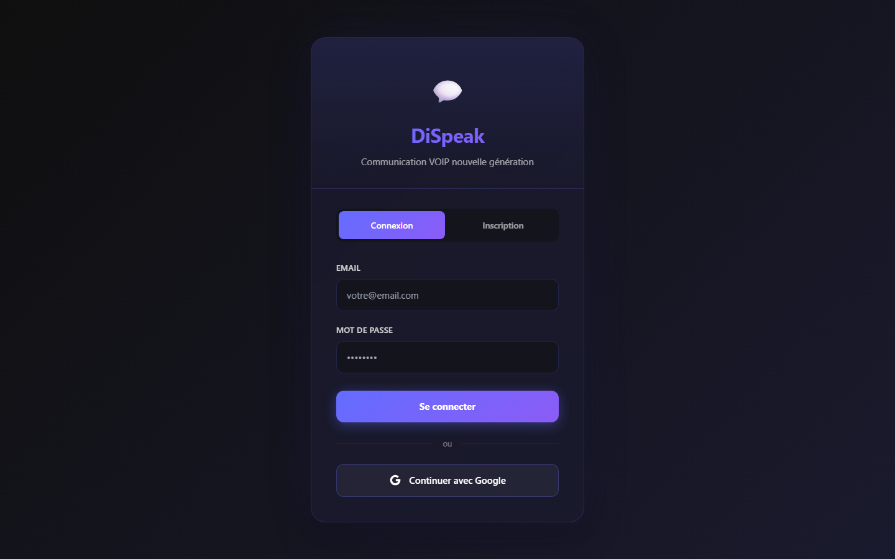
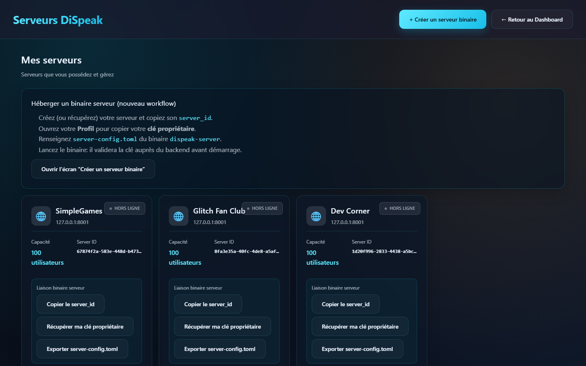
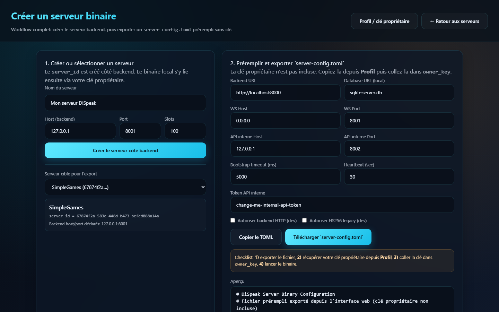
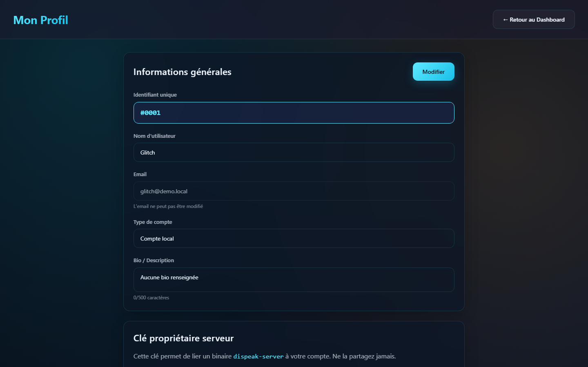
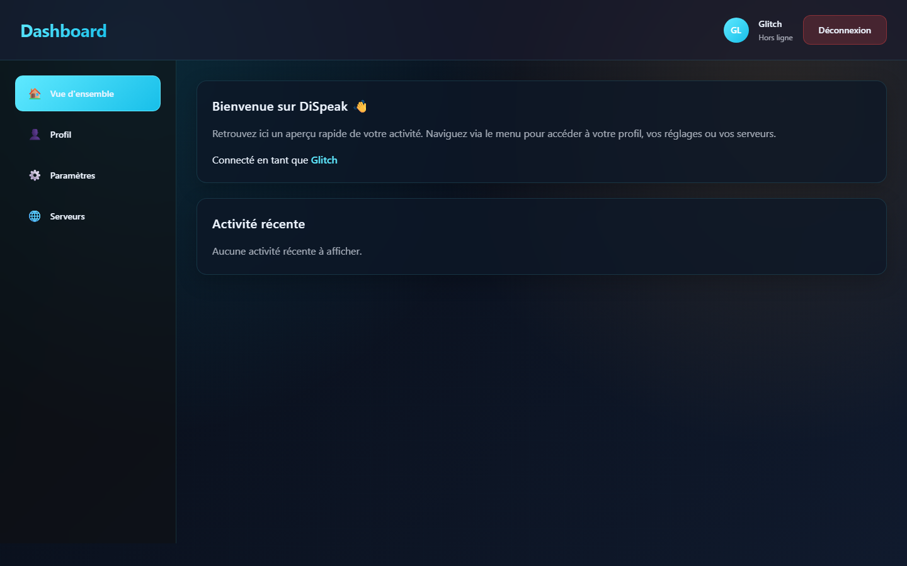
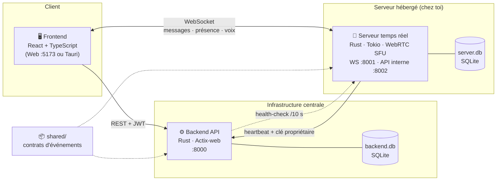

<div align="center">



<br/>

[](https://github.com/ThomasGJack/DiSpeak/actions/workflows/ci.yml)


**Une alternative à Discord, en Rust et React : serveurs, salons texte et vocaux, rôles et permissions — et tu héberges ton propre serveur.**

[Fonctionnalités](#-fonctionnalités) · [Captures](#-captures-décran) · [Architecture](#-architecture) · [Démarrage rapide](#-démarrage-rapide) · [Documentation](#-documentation)

</div>

---

## ✨ Fonctionnalités

| | |
|---|---|
| 💬 **Chat temps réel** | Messages instantanés via WebSocket, historique, présence en ligne |
| 🔊 **Salons vocaux** | Audio via **WebRTC** avec un SFU (*Selective Forwarding Unit*) côté serveur |
| 🗂️ **Serveurs, catégories & salons** | Création, réorganisation par glisser-déposer (dnd-kit) |
| 🛡️ **Rôles & permissions** | Permissions en *bitfield*, matrice par rôle, surcharges par salon et par membre |
| 🔐 **Authentification** | Compte local (JWT + refresh) ou **Google OAuth** |
| 🖥️ **Serveur auto-hébergé** | Le binaire `dispeak-server` se lie à ton compte via une **clé propriétaire** |
| ❤️ **Health-check** | Le backend vérifie les serveurs toutes les 10 s et les marque hors ligne automatiquement |
| 🧑‍⚖️ **Admin & modération** | Outils d'administration et de modération intégrés |
| 🪟 **App desktop** | Application **Tauri** avec barre de titre personnalisée (Windows) |

## 📸 Captures d'écran

<table>
  <tr>
    <td width="50%"><p align="center"><b>Connexion / inscription</b></p></td>
    <td width="50%"><p align="center"><b>Mes serveurs</b></p></td>
  </tr>
  <tr>
    <td width="50%"><p align="center"><b>Créer un serveur + export <code>server-config.toml</code></b></p></td>
    <td width="50%"><p align="center"><b>Profil & clé propriétaire</b></p></td>
  </tr>
  <tr>
    <td colspan="2"><p align="center"><b>Dashboard</b></p></td>
  </tr>
</table>

## 🏗️ Architecture

DiSpeak est découpé en **4 briques** qui communiquent entre elles :



| Composant | Dossier | Rôle |
|---|---|---|
| **Backend API** | [`backend/`](backend) | Utilisateurs, serveurs, licences, rôles, auth JWT, surveillance des serveurs |
| **Serveur temps réel** | [`server/`](server) | WebSocket, messages, présence, voix (WebRTC/SFU), permissions côté serveur |
| **Frontend** | [`frontend/`](frontend) | Interface React (Vite + Tailwind + Radix UI), empaquetée en app desktop avec Tauri |
| **Crate partagée** | [`shared/`](shared) | Types d'événements WebSocket typés (`ClientEvent`, `ServerEvent`…) communs aux deux binaires Rust |

👉 Détails complets : [`ARCHITECTURE.md`](ARCHITECTURE.md)

## 🚀 Démarrage rapide

### Prérequis

- [Rust](https://rustup.rs/) (stable)
- [Node.js](https://nodejs.org/) 20+
- Windows pour les scripts fournis (les services tournent aussi sous Linux/macOS)

### Configuration

Copie les fichiers d'exemple puis adapte-les :

```bash
cp .env.example .env
cp backend/.env.example backend/.env
cp server/.env.example server/.env
```

### Lancement (Windows)

```bat
scripts\windows\start.bat
```

ou en PowerShell :

```powershell
.\scripts\windows\start.ps1
```

Puis choisis dans le menu :

| Option | Action |
|:---:|---|
| `4` | Démarrer **tout** (backend + serveur + frontend) |
| `5` | Démarrer l'app **Tauri** (desktop) |
| `7` | Créer un serveur de test avec des salons par défaut |
| `9` | Vérifier l'état des services |

### Lancement manuel

```bash
# Terminal 1 — Backend API
cd backend && cargo run

# Terminal 2 — Serveur temps réel
cd server && cargo run --bin dispeak-server

# Terminal 3 — Frontend web (ou `npm run tauri:dev` pour le desktop)
cd frontend && npm install && npm run dev
```

### URLs utiles

| Service | URL |
|---|---|
| Frontend | http://127.0.0.1:5173 |
| Backend API | http://127.0.0.1:8000 |
| WebSocket | ws://127.0.0.1:8001 |
| API interne serveur (health) | http://127.0.0.1:8002/health |

## 🏠 Héberger ton propre serveur

1. Dans l'app, ouvre **Serveurs → Créer un serveur binaire** (`#/servers/binary/new`).
2. Crée le serveur côté backend et **exporte `server-config.toml`** (pré-rempli, sans clé).
3. Dans **Profil** (`#/profile`), copie ta **clé propriétaire** et colle-la dans `owner_key`.
4. Lance le binaire `dispeak-server` : il valide la clé auprès du backend puis démarre.

Guides détaillés : [héberger un serveur](docs/09-heberger-un-serveur-binaire.md) · [configurer `server-config.toml`](docs/10-configurer-server-config-toml.md) · [clé propriétaire](docs/11-cle-proprietaire-et-liaison-backend.md)

## 📚 Documentation

| # | Guide |
|:---:|---|
| 01 | [Lancer l'app](docs/01-lancer-l-app.md) |
| 02 | [Créer un compte et se connecter](docs/02-creer-un-compte-et-se-connecter.md) |
| 03 | [Créer un serveur](docs/03-creer-un-serveur.md) |
| 04 | [Propriétaire d'un serveur](docs/04-proprietaire-d-un-serveur.md) |
| 05 | [Rejoindre un serveur](docs/05-rejoindre-un-serveur.md) |
| 06 | [Gérer la structure et les rôles](docs/06-gerer-structure-et-roles.md) |
| 07 | [Dépannage](docs/07-depannage.md) |
| 08 | [Admin et modération](docs/08-admin-et-moderation.md) |
| 09 | [Héberger un serveur (binaire)](docs/09-heberger-un-serveur-binaire.md) |
| 10 | [Configurer `server-config.toml`](docs/10-configurer-server-config-toml.md) |
| 11 | [Clé propriétaire et liaison backend](docs/11-cle-proprietaire-et-liaison-backend.md) |

Scripts Windows : [`scripts/windows/README.md`](scripts/windows/README.md)

## 🗂️ Structure du projet

```
DiSpeak/
├── backend/          # API REST (Actix-web) + migrations SQLite
├── server/           # Serveur temps réel (WebSocket, WebRTC SFU)
├── shared/           # Contrats d'événements partagés (crate Rust)
├── frontend/         # React + Vite + Tailwind
│   └── src-tauri/    # Coquille desktop Tauri
├── docs/             # Guides utilisateur pas à pas
├── scripts/windows/  # Gestionnaire de lancement (bat / ps1)
└── ARCHITECTURE.md   # Documentation technique complète
```

---

<div align="center">
<sub>Fait avec 🦀 Rust et ⚛️ React par <a href="https://github.com/ThomasGJack">ThomasGJack</a></sub>
</div>
